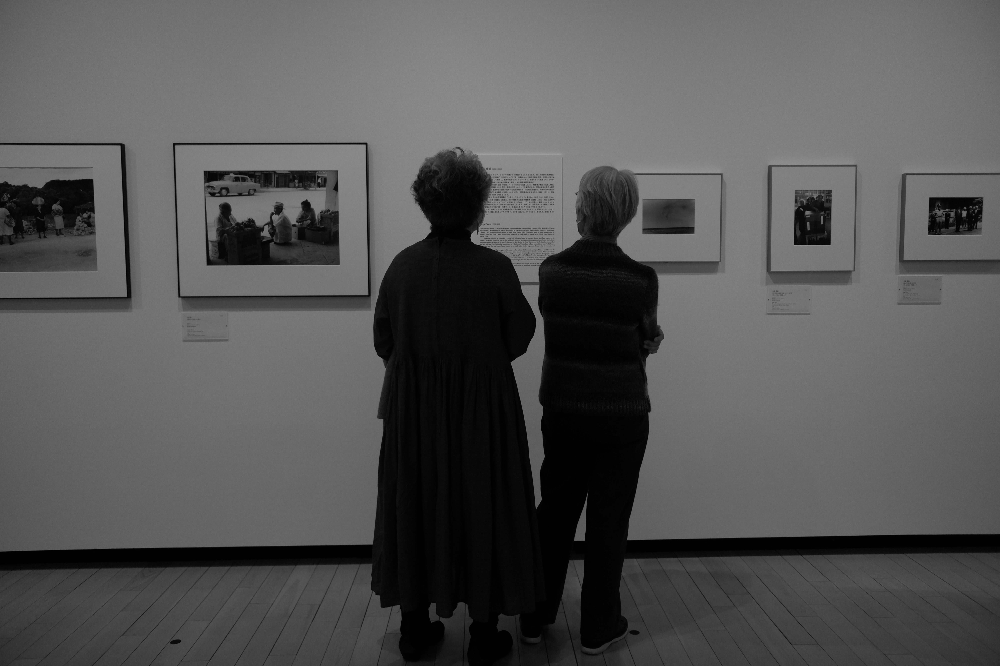
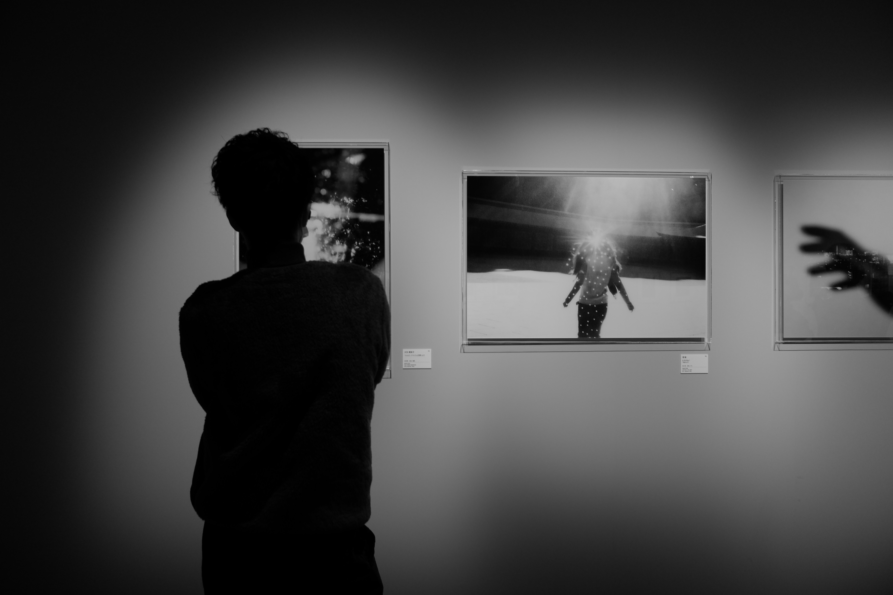
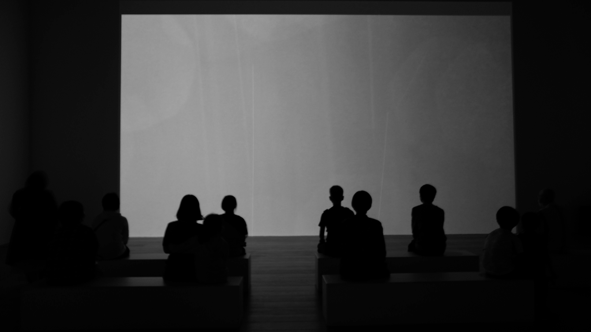

---
# 操作：修改 title 和正文；移动正文图片引用可调整顺序。
# 补图放本包 assets/，自动命名并补引用；保持 id、目录和发布时间不变。
id: gazing
title: gazing

module: stills
submodule: roll
topic: null

type: log
status: published
canonical: true

summary: null

parents: []
related: []

tags: []

audience:
- public
languages:
- zh
- en
- ja

maturity: stable
confidence: null

visibility: public
source_of_truth: site

filename_policy: entrypoint

created: '2026-05-24'
updated: '2026-05-24'
metadata_updated: '2026-11-01'

extra:
  profile: site-post-v1
  published_at: '2026-05-24T04:43:59+08:00'
  author: 五月七日
  images:
  - file: assets/20260524-044359-stills-0212d0ecbffb-001.jpg
    alt: 20201004gazing-1
  - file: assets/20260524-044359-stills-0212d0ecbffb-002.jpg
    alt: 20201004gazing-2
  - file: assets/20260524-044359-stills-0212d0ecbffb-003.jpg
    alt: 20201004gazing-3
  display_date: '2026-05-24'
  alt: gazing
  stills_layout: body-v1
---
<!-- stills-layout: body-v1 -->

